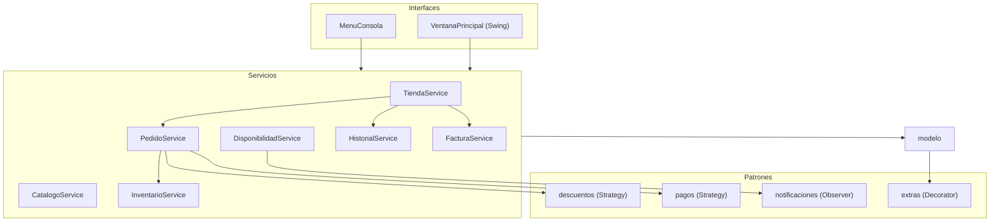
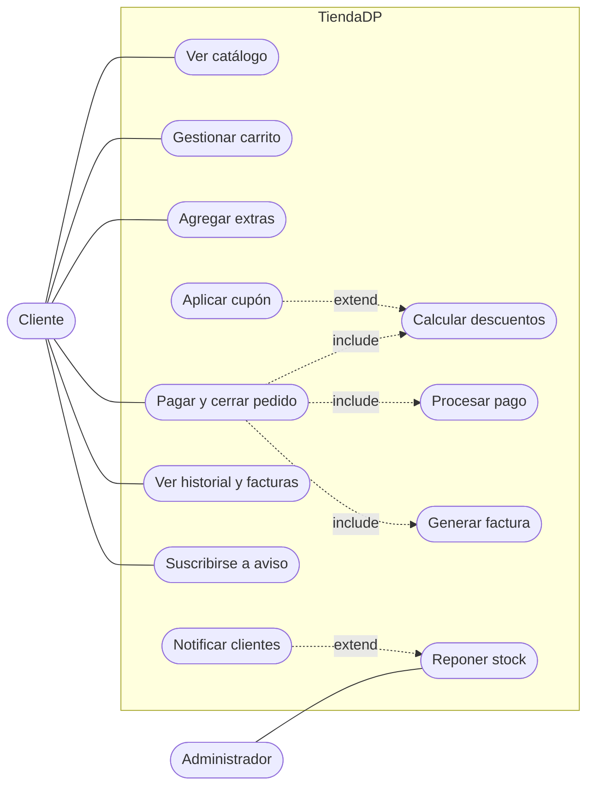
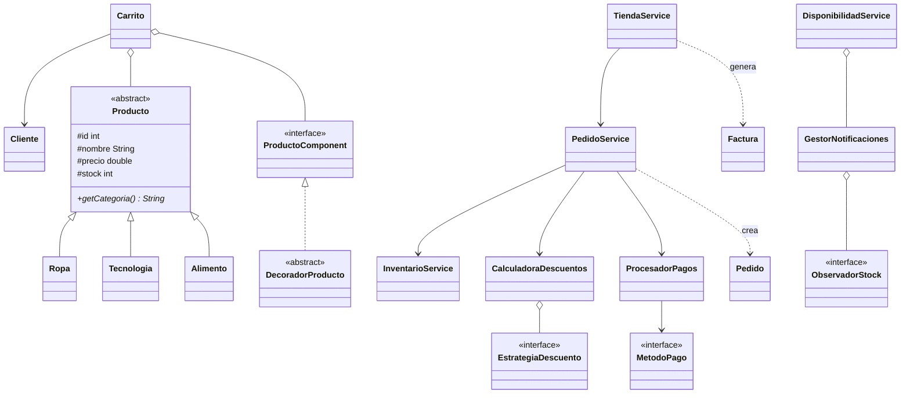
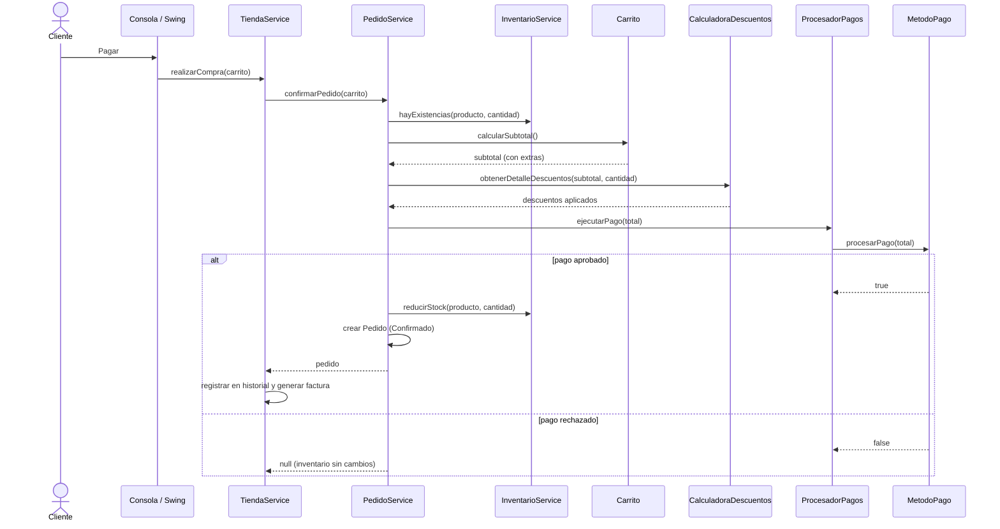
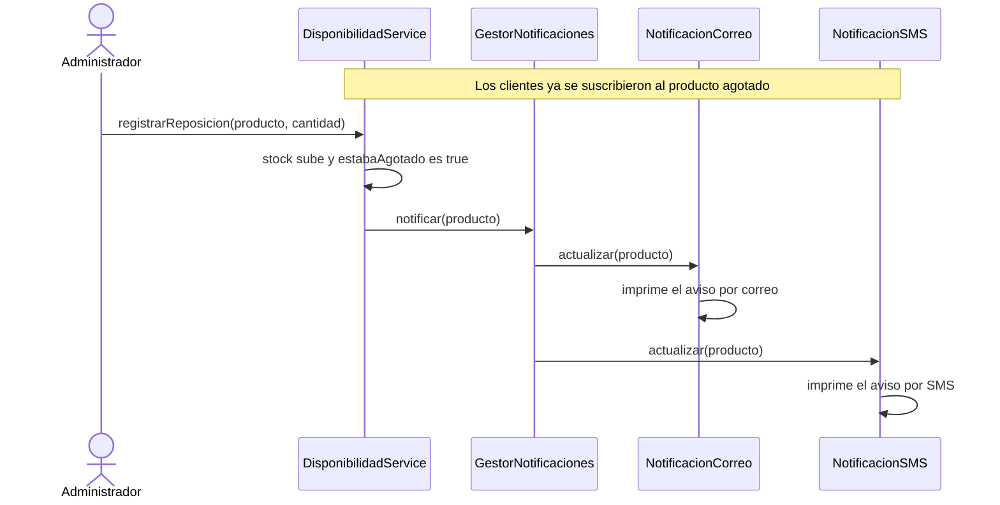
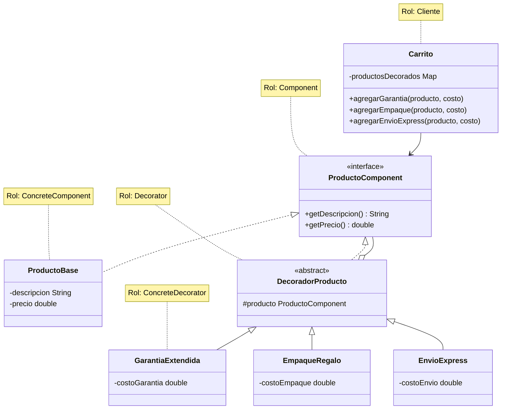
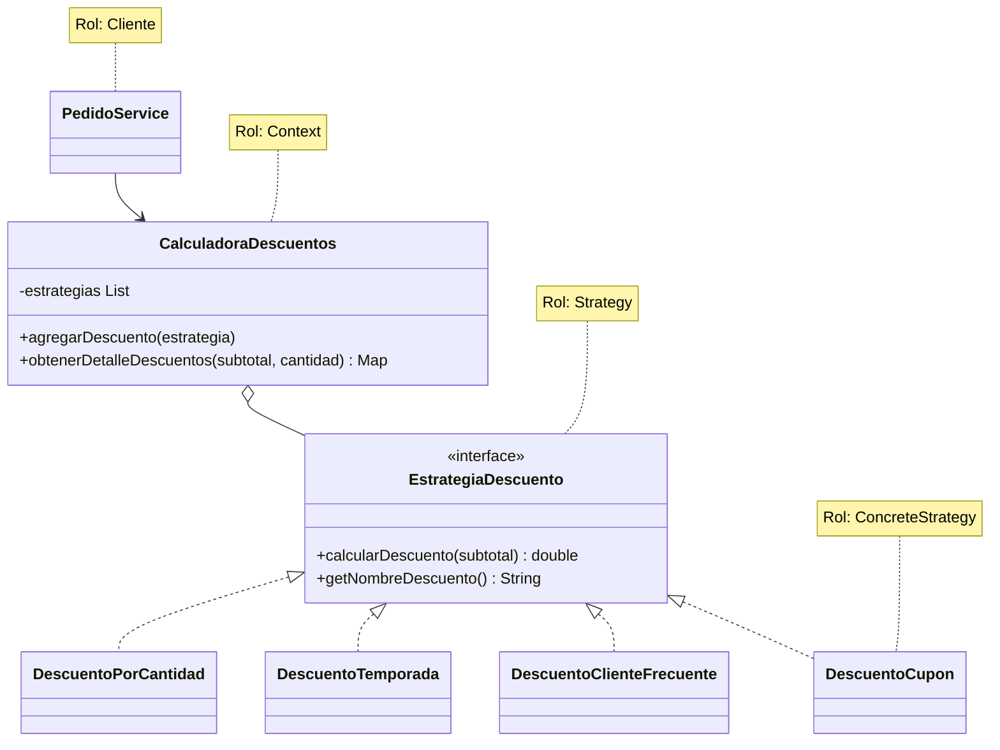
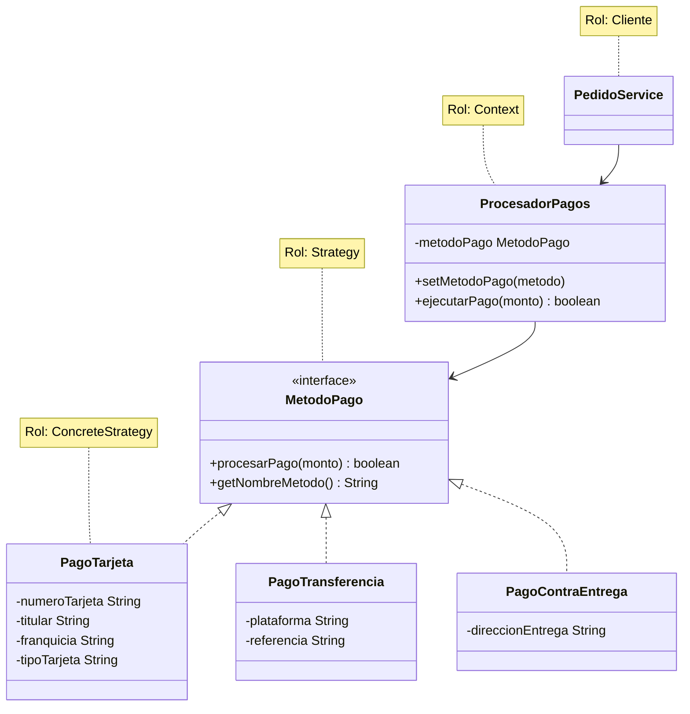
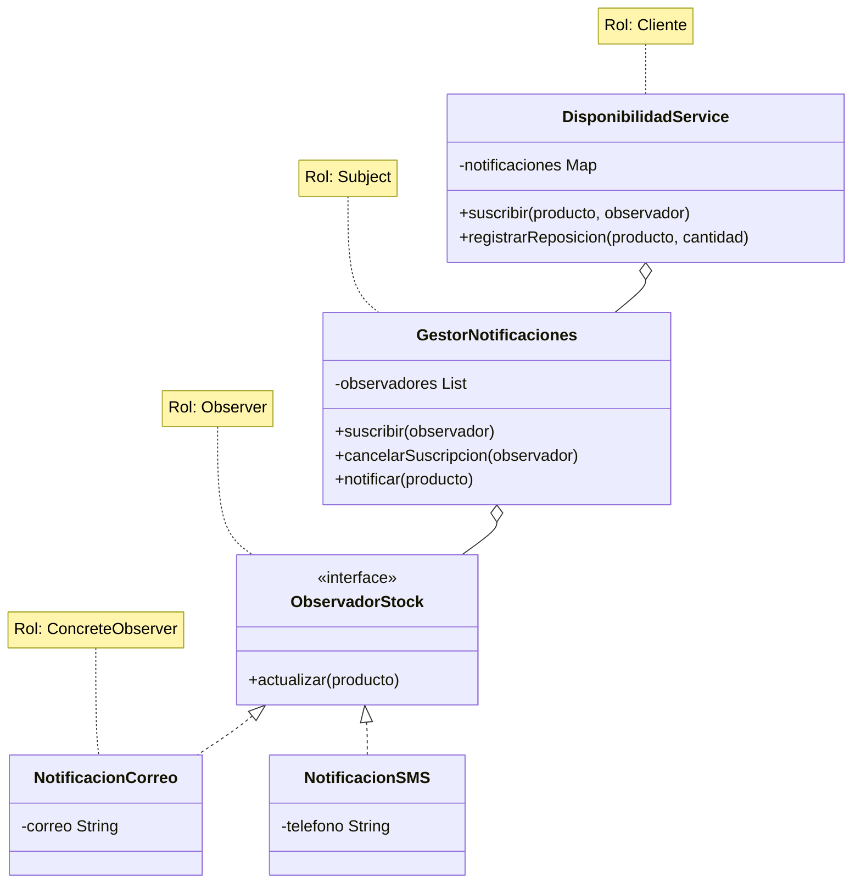

# Proyecto-Ingenieria-de-software2

# TiendaDP: Tienda Virtual

**Parcial 3 · Patrones de Diseño · Ingeniería de Software 2**

Tienda en línea hecha en Java, con una versión de consola y una ventana en Swing. Está pensada para aplicar patrones de diseño a problemas reales de una tienda: extras de un producto, descuentos, medios de pago y avisos de reposición.

**Integrantes:** Juan Ospina, Juan Rodriguez y Erick Penagos

## Contenido

1. [Introducción](#1-introducción)
2. [Alcance](#2-alcance)
3. [Requisitos](#3-requisitos)
4. [Problemas de diseño y patrones elegidos](#4-problemas-de-diseño-y-patrones-elegidos)
5. [Arquitectura](#5-arquitectura)
6. [Diagramas UML](#6-diagramas-uml)
7. [Documento de diseño por patrón](#7-documento-de-diseño-por-patrón)
8. [Pruebas unitarias](#8-pruebas-unitarias)
9. [Cómo compilar y ejecutar](#9-cómo-compilar-y-ejecutar)
10. [Limitaciones y trabajo futuro](#10-limitaciones-y-trabajo-futuro)
11. [Conclusiones](#11-conclusiones)
12. [Declaración de uso de IA](#12-declaración-de-uso-de-ia)

---

## 1. Introducción

TiendaDP simula el proceso de compra de una tienda: el cliente mira el catálogo, arma un carrito, le agrega extras a los productos, aplica descuentos, paga con un medio de pago simulado y recibe una factura. También puede suscribirse al aviso de un producto agotado para enterarse cuando vuelva a tener existencias.

El proyecto tiene dos formas de usarse:

- **Consola:** clase `Main` con el menú de `MenuConsola`.
- **Ventana Swing:** clase `VentanaPrincipal`.

Las dos usan las mismas clases de modelo, servicios y patrones. Cada interfaz crea sus propias instancias de los servicios al arrancar.

Este documento explica el alcance, los requisitos, los problemas de diseño, los patrones que usamos y por qué, y los diagramas UML. Todo está escrito sobre el código que hay en este repositorio.

## 2. Alcance

### Lo que sí hace el sistema

| Funcionalidad | Qué incluye |
|---|---|
| Catálogo | Tres categorías: ropa (talla y material), tecnología (marca y meses de garantía) y alimentos (fecha de vencimiento y tipo). |
| Carrito | Agregar productos, cambiar cantidades y eliminarlos. |
| Extras | Garantía extendida, empaque de regalo y envío exprés, combinables sobre un mismo producto. |
| Descuentos | Por cantidad, por temporada, por cliente frecuente y por cupón. |
| Pagos simulados | Tarjeta, transferencia y pago contra entrega. |
| Pedidos | Verificación de stock, pago, descuento de inventario y estado del pedido. |
| Factura e historial | Factura con el detalle de la compra e historial de pedidos del cliente. |
| Avisos de reposición | El cliente se suscribe a un producto y recibe un aviso cuando vuelve a haber stock. |

### Lo que dejamos por fuera

| Qué | Por qué |
|---|---|
| Base de datos o archivos | Todo vive en memoria mientras corre el programa. |
| Registro de usuarios con contraseña | No aporta a los patrones. El cliente se crea con sus datos al iniciar. |
| Pasarelas de pago reales | El enunciado pide pagos simulados. |
| Logística de envíos y devoluciones | El envío exprés es solo un extra con costo. |
| Correo y SMS reales | Los avisos son simulados: se imprimen como mensajes en la consola. |
| Aplicación web | No es obligatoria en el enunciado. |

### Zonas con variación o cambio frecuente

Identificamos cuatro, y cada una se resuelve con un patrón:

1. Extras de un producto (Decorator)
2. Descuentos (Strategy)
3. Medios de pago (Strategy)
4. Avisos de reposición (Observer)

## 3. Requisitos

### 3.1 Requisitos funcionales

| ID | Requisito |
|---|---|
| RF-01 | Mostrar el catálogo de productos con los atributos propios de cada categoría. |
| RF-02 | Agregar productos al carrito, cambiar su cantidad y eliminarlos. |
| RF-03 | Agregar extras a un producto del carrito: garantía extendida, empaque de regalo y envío exprés. Se pueden combinar. |
| RF-04 | Aplicar descuentos automáticamente: por cantidad (10 % desde 5 unidades en el carrito), por temporada (10 % en Navidad, San Valentín y Día de la Madre), por cliente frecuente (5 %) y por cupón (código `TIENDA10`, 10 %). |
| RF-05 | Pagar con tarjeta (franquicia, tipo, titular y número), transferencia (plataforma y referencia) o contra entrega (dirección). |
| RF-06 | Confirmar el pedido: verificar existencias, calcular el total con descuentos, procesar el pago, descontar el inventario y guardar el pedido. Si el pago falla, el pedido no se confirma y el inventario no cambia. |
| RF-07 | Poder cambiar el medio de pago y reintentar si un pago es rechazado. |
| RF-08 | Generar la factura de cada pedido con productos, extras, descuentos aplicados y método de pago. |
| RF-09 | Consultar el historial de pedidos del cliente y sus facturas. |
| RF-10 | Suscribirse y cancelar la suscripción al aviso de un producto. |
| RF-11 | Al reponer un producto agotado, avisar a todos los clientes suscritos. |
| RF-12 | Ofrecer las mismas operaciones por consola y por ventana Swing. |

### 3.2 Requisitos no funcionales

| ID | Requisito | Cómo lo cumplimos |
|---|---|---|
| RNF-01 | **Extensibilidad.** Agregar un descuento, medio de pago, extra o tipo de aviso se hace con una clase nueva. | Los patrones Strategy, Decorator y Observer. |
| RNF-02 | **Organización.** Código separado por paquetes según su responsabilidad. | Paquetes `modelo`, `servicios`, `extras`, `descuentos`, `pagos`, `notificaciones`, `consola` y `grafica`. |
| RNF-03 | **Pruebas.** Pruebas unitarias con JUnit 5. | 11 clases de prueba en la carpeta `test`. |
| RNF-04 | **Usabilidad.** Menú de consola con mensajes claros y una ventana con imágenes de los productos. | `MenuConsola` y `VentanaPrincipal`. |
| RNF-05 | **Portabilidad.** Java estándar, sin librerías externas salvo JUnit. | Proyecto de NetBeans (Ant). |
| RNF-06 | **Trazabilidad.** Repositorio Git con los commits de cada integrante. | Historial de commits de este repositorio. |

## 4. Problemas de diseño y patrones elegidos

### Problema 1: extras combinables sobre un producto

**Situación.** El cliente puede agregarle a un producto garantía extendida, empaque de regalo, envío exprés o cualquier combinación, y cada extra cambia el precio y la descripción.

**Ejemplo.** Una camiseta de $45.000 con empaque de regalo ($5.000) y envío exprés ($10.000) pasa a costar $60.000 y su descripción dice "Camiseta negra + Empaque de regalo + Envío exprés".

**Diseño ingenuo.** Una subclase por cada combinación (`ProductoConGarantiaYEnvio`, etc.). Con tres extras son ocho combinaciones, y un extra nuevo las duplica.

**Patrón elegido: Decorator (estructural).**

### Problema 2: descuentos con reglas distintas

**Situación.** Hay cuatro tipos de descuento y cada uno tiene su propia condición y su propio cálculo.

**Ejemplo.** Seis camisetas en diciembre: aplican el descuento por cantidad y el de temporada, y cada uno se calcula distinto.

**Diseño ingenuo.** Un método `calcularTotal()` en `Carrito` con `if` anidados para cada descuento. Un descuento nuevo obliga a editar ese método.

**Patrón elegido: Strategy (comportamiento).**

### Problema 3: medios de pago diferentes

**Situación.** Cada medio de pago pide datos distintos y valida cosas distintas, y el cliente debe poder cambiar de medio si uno falla.

**Ejemplo.** La tarjeta pide franquicia, tipo, titular y número, la transferencia pide plataforma y referencia, y contra entrega pide dirección.

**Diseño ingenuo.** Un `switch` en un método `pagar()` o subclases de `Pedido` por medio de pago, que fijan el medio y no dejan cambiarlo después de un rechazo.

**Patrón elegido: Strategy (comportamiento).**

### Problema 4: avisar cuando vuelve un producto agotado

**Situación.** Cuando un producto agotado recibe stock, los clientes interesados deben enterarse sin que el inventario conozca los detalles de cada uno.

**Ejemplo.** Tres clientes se suscribieron a los audífonos agotados. Al reponerlos, cada uno recibe su aviso, uno por correo y otro por SMS.

**Diseño ingenuo.** Que el inventario guarde una lista de clientes y los llame directamente, o que cada cliente consulte el stock una y otra vez.

**Patrón elegido: Observer (comportamiento).**

### Resumen

| Problema | Patrón | Categoría | Alternativa descartada |
|---|---|---|---|
| Extras combinables | Decorator | Estructural | Una subclase por combinación |
| Descuentos | Strategy | Comportamiento | `if` anidados en el carrito |
| Medios de pago | Strategy | Comportamiento | `switch` o subclases de pedido |
| Aviso de reposición | Observer | Comportamiento | Inventario que llama a cada cliente |

## 5. Arquitectura

El proyecto se organiza por paquetes dentro de `com.tiendavirtual`:

| Paquete | Contenido | Patrón |
|---|---|---|
| `consola` | `MenuConsola`: menú de texto. | - |
| `grafica` | `VentanaPrincipal`: ventana Swing. | - |
| `servicios` | `CatalogoService`, `InventarioService`, `DisponibilidadService`, `PedidoService`, `FacturaService`, `HistorialService`, `TiendaService` y `RegistroProductos`. | - |
| `modelo` | `Producto` (abstracta) con `Ropa`, `Tecnologia` y `Alimento`, más `Cliente`, `Carrito`, `Pedido` y `Factura`. | - |
| `extras` | `ProductoComponent`, `ProductoBase`, `DecoradorProducto`, `GarantiaExtendida`, `EmpaqueRegalo` y `EnvioExpress`. | Decorator |
| `descuentos` | `EstrategiaDescuento`, los cuatro descuentos y `CalculadoraDescuentos`. | Strategy |
| `pagos` | `MetodoPago`, `PagoTarjeta`, `PagoTransferencia`, `PagoContraEntrega` y `ProcesadorPagos`. | Strategy |
| `notificaciones` | `ObservadorStock`, `NotificacionCorreo`, `NotificacionSMS` y `GestorNotificaciones`. | Observer |



*Figura 1. Arquitectura por paquetes.*

## 6. Diagramas UML

### 6.1 Casos de uso



*Figura 2. Casos de uso.*

### 6.2 Diagrama de clases general



*Figura 3. Diagrama de clases general. El detalle de cada patrón está en la sección 7.*

### 6.3 Secuencia: confirmar un pedido



*Figura 4. Confirmación de un pedido.*

### 6.4 Secuencia: aviso de reposición



*Figura 5. Reposición de stock y aviso a los suscritos.*

## 7. Documento de diseño por patrón

En los diagramas de clases de cada patrón, la nota sobre cada clase indica su rol.

### 7.1 Decorator: extras de un producto

#### Cómo funciona

Decorator envuelve un objeto dentro de otro que cumple la misma interfaz. Cada envoltorio suma lo suyo y le pasa el resto al objeto envuelto. Como todos son del mismo tipo, se pueden apilar en cualquier orden.

En el carrito, cada producto se guarda junto a un `ProductoBase` (su nombre y precio). Al agregar un extra, ese objeto se envuelve en un decorador (por ejemplo `new EmpaqueRegalo(decorado, costo)`) y se vuelve a guardar. El precio final sale de recorrer la cadena.



*Figura 6. Decorator.*

| Rol | Clase |
|---|---|
| Component | `ProductoComponent` |
| ConcreteComponent | `ProductoBase` |
| Decorator | `DecoradorProducto` |
| ConcreteDecorator | `GarantiaExtendida`, `EmpaqueRegalo`, `EnvioExpress` |
| Cliente | `Carrito` |

**Alternativa descartada.** Una subclase por combinación de extras, que se vuelve inmanejable con solo tres extras.

**Ventajas.** Un extra nuevo es una clase nueva. Los extras se combinan libremente. Cada extra guarda solo su costo y su texto.

**Desventajas.** Más clases pequeñas. El objeto decorado no es el producto original, así que el carrito guarda aparte la relación entre ambos.

**SOLID.** Abierto/cerrado (agregar extras sin modificar los existentes), responsabilidad única (cada decorador maneja un solo extra) y sustitución de Liskov (un decorador se usa donde se espera un `ProductoComponent`).

### 7.2 Strategy: descuentos

#### Cómo funciona

Strategy pone cada algoritmo en su propia clase detrás de una interfaz común. Acá, cada descuento implementa `EstrategiaDescuento` con su cálculo, y `CalculadoraDescuentos` guarda la lista de estrategias y las recorre para calcular el total. Es una variante donde el contexto usa varias estrategias a la vez, porque en un pedido pueden aplicar varios descuentos.

Los valores que registra el menú son estos:

| Descuento | Condición | Valor |
|---|---|---|
| `DescuentoPorCantidad` | 5 o más unidades en el carrito | 10 % |
| `DescuentoTemporada` | Fecha de compra en Navidad (1 al 25 de diciembre), San Valentín o Día de la Madre | 10 % |
| `DescuentoClienteFrecuente` | Cliente con 5 compras o más | 5 % |
| `DescuentoCupon` | Código `TIENDA10` | 10 % |



*Figura 7. Strategy aplicado a los descuentos.*

| Rol | Clase |
|---|---|
| Strategy | `EstrategiaDescuento` |
| ConcreteStrategy | `DescuentoPorCantidad`, `DescuentoTemporada`, `DescuentoClienteFrecuente`, `DescuentoCupon` |
| Context | `CalculadoraDescuentos` |
| Cliente | `PedidoService` |

**Alternativa descartada.** `if` anidados dentro de `Carrito`. Con cada descuento nuevo habría que reescribir el método y revisar todas las combinaciones.

**Ventajas.** Cada descuento es una clase independiente y se prueba sola. Un descuento nuevo no cambia a los demás.

**Desventajas.** `DescuentoPorCantidad` necesita la cantidad de productos, que la interfaz no recibe, y por eso la calculadora lo trata aparte con `instanceof`. Es un punto donde el patrón no quedó limpio (ver sección 10).

**SOLID.** Abierto/cerrado, responsabilidad única (cada clase una regla) e inversión de dependencias (la calculadora depende de la interfaz).

### 7.3 Strategy: medios de pago

#### Cómo funciona

Es el mismo patrón aplicado a otro problema. Cada medio de pago implementa `MetodoPago` (`procesarPago` y `getNombreMetodo`), y `ProcesadorPagos` guarda el medio elegido y lo ejecuta. Como el medio se puede cambiar con `setMetodoPago`, si un pago falla el cliente puede elegir otro y reintentar sobre el mismo carrito.



*Figura 8. Strategy aplicado a los medios de pago.*

| Rol | Clase |
|---|---|
| Strategy | `MetodoPago` |
| ConcreteStrategy | `PagoTarjeta`, `PagoTransferencia`, `PagoContraEntrega` |
| Context | `ProcesadorPagos` |
| Cliente | `PedidoService` |

**Alternativa descartada.** Un `switch` dentro de `pagar()`, que mezcla reglas sin relación y crece con cada medio nuevo. También subclases de `Pedido`, que fijan el medio al crear el pedido.

**Ventajas.** Un medio nuevo (por ejemplo una billetera digital) es una clase nueva. El medio se cambia en tiempo de ejecución. Cada medio valida solo sus datos.

**Desventajas.** Para mostrar el detalle del pago en la factura, `ProcesadorPagos` consulta el tipo concreto con `instanceof`.

**SOLID.** Abierto/cerrado, responsabilidad única, inversión de dependencias y sustitución de Liskov.

### 7.4 Observer: aviso de reposición

#### Cómo funciona

Observer es una relación de uno a muchos: un sujeto avisa automáticamente a sus observadores cuando algo cambia, y solo los conoce por una interfaz. Acá, `GestorNotificaciones` guarda la lista de `ObservadorStock` y `notificar(producto)` llama a `actualizar(producto)` de cada uno. `DisponibilidadService` tiene un gestor por producto, y cuando un producto agotado recibe stock llama a `notificar`.



*Figura 9. Observer.*

| Rol | Clase |
|---|---|
| Observer | `ObservadorStock` |
| ConcreteObserver | `NotificacionCorreo`, `NotificacionSMS` |
| Subject | `GestorNotificaciones` |
| Cliente | `DisponibilidadService` |

**Alternativa descartada.** Que el inventario guarde a los clientes y los llame directamente, o que cada cliente consulte el stock una y otra vez.

**Ventajas.** El sujeto no sabe cómo se avisa. Un canal nuevo (por ejemplo WhatsApp) es una clase que implementa `ObservadorStock`. Los clientes se enteran en el momento exacto.

**Desventajas.** El orden de los avisos no está garantizado. El sujeto es una clase concreta y no una interfaz.

**SOLID.** Abierto/cerrado, responsabilidad única e inversión de dependencias (el gestor depende de `ObservadorStock`).

## 8. Pruebas unitarias

Las pruebas usan JUnit 5 y están en la carpeta `test`:

| Paquete | Clases de prueba |
|---|---|
| `descuentos` | `CalculadoraDescuentosTest`, `DescuentoPorCantidadTest` |
| `extras` | `DecoradorProductoTest` |
| `pagos` | `MetodosPagoTest`, `ProcesadorPagosTest` |
| `notificaciones` | `GestorNotificacionesTest` |
| `modelo` | `CarritoTest`, `PedidoTest` |
| `servicios` | `CatalogoServiceTest`, `InventarioServiceTest`, `FacturaServiceTest` |

## 9. Cómo compilar y ejecutar

**Con NetBeans (recomendado).** Abrir la carpeta del proyecto como proyecto de NetBeans.
- Consola: ejecutar `com.tiendavirtual.Main`.
- Ventana: ejecutar `com.tiendavirtual.grafica.VentanaPrincipal`.
- Pruebas: *Test Project* (Alt + F6).

**Por línea de comandos (solo consola).** Con un JDK instalado:

```bash
javac -encoding UTF-8 -d out $(find src -name '*.java')
java -cp out com.tiendavirtual.Main
```

## 10. Limitaciones y trabajo futuro

Estas son cosas que sabemos que se pueden mejorar:

- **Descuentos acumulados sin tope.** Los cuatro descuentos se suman sin una regla de acumulación; solo se limita a que el total no pase del subtotal.
- **Estrategia de cantidad.** `DescuentoPorCantidad` recibe la cantidad aparte y por eso la calculadora usa `instanceof`. Una mejora sería que la interfaz reciba el carrito.
- **Dinero con `double`.** Los valores monetarios usan `double`. Lo correcto sería `BigDecimal`.
- **Costos de extras fijos.** Los valores de los extras (garantía $15.000, empaque $5.000 y envío $10.000) están escritos en el menú. La factura imprime la garantía con un valor propio, y hay que alinearlos.
- **Avisos.** Los avisos de correo y SMS son simulados con mensajes en consola. Además, `InventarioService.aumentarStock` avisa siempre, mientras `DisponibilidadService` solo avisa si el producto estaba agotado.
- **Pagos.** Los medios de pago validan que los datos no estén vacíos, pero no aplican recargos, cuotas ni límites.
- **Factory Method.** Lo consideramos para crear productos por categoría, pero no lo implementamos: los productos se crean directamente en `RegistroProductos`.
- **Persistencia.** Todo está en memoria.

## 11. Conclusiones

- Describir cada problema con un ejemplo concreto hizo más fácil escoger el patrón.
- Un mismo patrón (Strategy) sirvió para dos problemas distintos, y lo que cambia es el contexto.
- Decorator nos obligó a guardar aparte el producto original y su versión decorada.
- Dejar los patrones en sus propios paquetes hizo más simple probarlos por separado.
- Al revisar el código encontramos puntos donde los patrones se podrían aplicar mejor, y los dejamos anotados en la sección 10.

## 12. Declaración de uso de IA

Usamos Claudecomo apoyo para organizar este documento y para verificar los diagramas. El grupo revisó el contenido y puede explicar cada decisión de diseño. Si se usa IA en otras partes del proyecto, esta declaración se actualiza.
